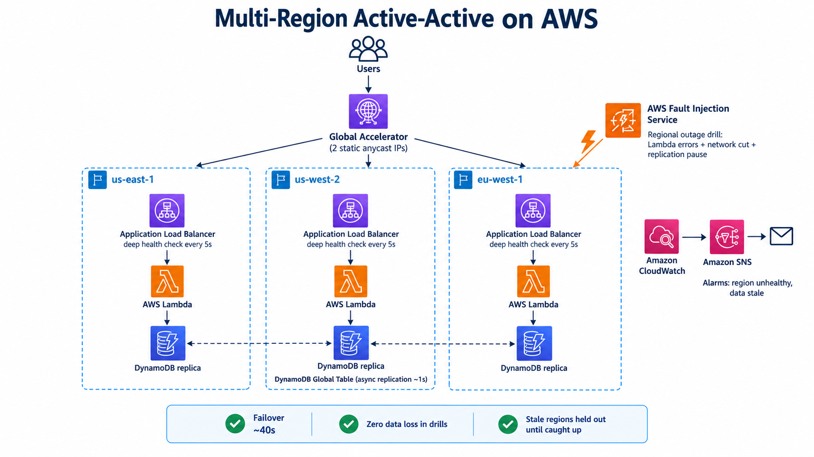

# Multi-Region Active-Active on AWS

An active-active service running in three AWS regions (us-east-1, us-west-2, eu-west-1), built with Terraform and tested with real regional outage drills using AWS Fault Injection Service (FIS).

Every region serves live traffic and accepts writes. If a region fails, users are moved to a healthy region automatically, no data is lost, and the failed region is only let back in once its data has caught up.

## Architecture



| Layer | Service | Role |
|---|---|---|
| Routing | Global Accelerator | Sends each user to the nearest healthy region; fails over without DNS caching delays |
| Load balancing | Application Load Balancer | Runs the deep health check every 5s |
| Compute | Lambda (Python 3.12) | The regional service and its health check |
| Data | DynamoDB Global Table | Multi-region, multi-active writes, ~1s async replication, last writer wins |
| Chaos | AWS FIS | Simulates a full regional outage |
| Monitoring | CloudWatch alarms + SNS | Emails when a region goes unhealthy or its data goes stale |

## The deep health check

`GET /health/deep` decides whether a region should receive traffic. It returns 200 only if all of these are true:

1. **The region can write** a probe row to its local DynamoDB replica.
2. **The region can read it back** with a consistent read.
3. **The region's data is fresh.** Every region writes a `HEALTH#<region>` heartbeat on each health check. These replicate everywhere, so each region reads its peers' heartbeats from its own replica. If even the *newest* peer heartbeat is more than 30s old, replication into this region has stopped and its data is stale, so it returns 503.

The freshness check uses the newest peer heartbeat, not the oldest, on purpose. If one region dies, its heartbeat goes stale everywhere. Checking the oldest would make every healthy region fail too and take the whole system down.

Each health check also publishes a `StaleSeconds` metric (via CloudWatch Embedded Metric Format), which drives the stale-data alarm.

## Repository layout

```
terraform/
  bootstrap/              S3 bucket for remote state (applied once)
  envs/dev/               The environment: providers, regions, Global Accelerator, FIS
  modules/
    global-table/         DynamoDB Global Table with replicas
    regional-stack/       Everything one region needs: VPC, ALB, Lambda, alarms
      lambda/handler.py   The service and deep health check
```

Every resource is tagged with `ChaosTarget`, `Layer` (`network`, `app` or `data`) and `Region`. FIS uses these tags to select what to break.

## Deploy

Requirements: Terraform >= 1.10 and AWS credentials.

```bash
# 1. Remote state bucket (once)
cd terraform/bootstrap && terraform init && terraform apply

# 2. The environment
cd ../envs/dev
echo 'alerts_email = "you@example.com"' > terraform.tfvars   # gitignored
terraform init
terraform apply
```

Then confirm the three SNS subscription emails (one per region), or alarms won't reach you.

```bash
terraform output global_url                          # the single entry point
curl "$(terraform output -raw global_url)/health/deep"
# {"region": "eu-west-1", "healthy": true, "lag_seconds": 2}
```

## Run a regional outage drill

The `euw1_region_outage` FIS template takes down eu-west-1 in three layers at once:

| Action | What it breaks |
|---|---|
| `aws:lambda:invocation-error` | The app: every Lambda invocation fails |
| `aws:network:disrupt-connectivity` | The network: all traffic in and out of the subnets is cut |
| `aws:dynamodb:global-table-pause-replication` | The data: replication to and from eu-west-1 stops |

Watch users in one terminal:

```bash
URL=$(terraform output -raw global_url)
while true; do
  r=$(curl -s -m 2 -w ' %{http_code}' $URL/health/deep); c=${r##* }
  g=$(echo "$r" | grep -o '"region": "[^"]*"' | cut -d'"' -f4)
  [ "$c" = 200 ] && echo "$(date +%T) ✔ served by $g" || echo "$(date +%T) ✘ ERROR $c"
  sleep 1
done
```

Watch Ireland's data lag in another terminal:

```bash
while true; do
  t=$(aws dynamodb get-item --region eu-west-1 --table-name my-global-table \
    --key '{"pk":{"S":"HEALTH#us-east-1"},"sk":{"S":"probe"}}' \
    --query Item.checked_at.S --output text)
  echo "$(date +%T) Ireland data is $(( $(date +%s) - ${t%.*} ))s behind"
  sleep 15
done
```

Start the drill (it runs for up to 15 minutes; stop it at any time and FIS rolls everything back):

```bash
aws fis start-experiment --region eu-west-1 \
  --experiment-template-id "$(terraform output -raw fis_euw1_outage_template_id)"
aws fis stop-experiment --region eu-west-1 --id <experiment-id>
```

## Results

Measured across repeated full-outage drills of eu-west-1:

| Metric | Result |
|---|---|
| Failover time (user-visible errors) | 42–80s in drills; ~35s expected in a real outage (see below) |
| Data loss (RPO) | None. Writes made in us-east-1 during the outage reached Ireland within seconds of replication resuming |
| Max staleness held out of rotation | 534s (~9 min): Ireland was kept out until its data caught up |
| Failback | Automatic, with no errors, only after data was current |
| Alarm notification | ~2.5 min after the outage started |

### Where failover time goes

FIS action timestamps plus per-minute Lambda and ALB metrics broke one 80s failover down like this:

| Stage | Time |
|---|---|
| FIS fault reaches the Lambda (drill artifact; a real outage has no delivery delay) | ~0–45s, varies per run |
| ALB marks the target unhealthy (2 failed checks × 5s) | ~10s |
| Global Accelerator moves traffic | ~25s |

### What the drills found and fixed

1. **Failback served stale data.** In the first full drill, eu-west-1 took users back about 90s before its data caught up, serving reads that were up to 9.5 minutes old. The health check only tested local reads and writes. **Fix:** the freshness check above. Later drills held Ireland out until its data was current.
2. **Slow detection.** The original 10s/5s health check settings, plus FIS's default 60s fault poll, gave ~90s of errors. **Fix:** a 5s interval with a 2s timeout, and a 5s FIS poll.
3. **A blind spot (not fixed).** The ALB reaches the Lambda without going through the VPC network, so a network-only failure (for example, a bad NACL) breaks users without failing the health check. A synthetic canary that calls each region's public URL would close it.

## Known limitations

- **~35s is the floor for server-side failover** with Global Accelerator. Going lower needs clients that retry against another region on timeout.
- **RPO is not guaranteed to be zero.** Replication is asynchronous (~1s), so a write acknowledged just before a region dies can be lost. DynamoDB multi-region strong consistency (MRSC) would fix this at the cost of write latency.
- **Concurrent writes resolve last writer wins.** Two regions writing the same item at the same time will lose one of the writes.
- **Two simultaneous region failures:** the surviving region sees both peers' heartbeats go stale and marks itself unhealthy. With every endpoint unhealthy, Global Accelerator sends traffic to all of them.

## Cost and teardown

Roughly $0.09/hour while running (3 ALBs plus Global Accelerator; Lambda, DynamoDB and alarms are near zero at this traffic). FIS costs about $0.10 per action-minute during drills.

```bash
cd terraform/envs/dev && terraform destroy
```
